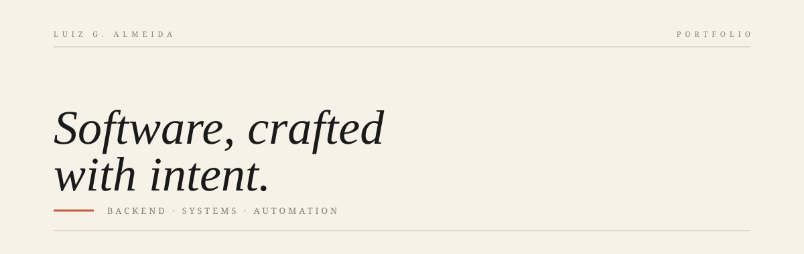

  

 

Sou **desenvolvedor** em **[cidade]**. Passo os dias **[o que você realmente faz — seja específico: "construindo backends que aguentam tráfego real" / "automatizando o que ninguém quer fazer à mão" / etc.]**, e as noites **[um detalhe verdadeiro: "lendo código-fonte de bibliotecas que uso" / "quebrando coisas em containers" / etc.]**.

Cuido de software como um marceneiro cuida de uma junta: ela deve ser invisível, estrutural, e feita para durar mais que quem a fez.

 

---

<h3><code>§ 01</code> &nbsp; Now</h3>

**Building** &nbsp;·&nbsp; [projeto específico, uma linha]
**Learning** &nbsp;·&nbsp; [coisa específica, uma linha]
**Reading** &nbsp;·&nbsp; [livro, uma linha]
**Open to** &nbsp;·&nbsp; [o que você está aberto — colaborações, conversas, freelance]

<i>Última atualização em [mês/ano].</i>

---

<h3><code>§ 02</code> &nbsp; Selected Work</h3>

**[Nome do projeto]** — [uma linha sobre o problema e a solução, sem hype].
`Stack` · `Stack` · [`→`](link)

**[Nome do projeto]** — [uma linha sobre o problema e a solução, sem hype].
`Stack` · `Stack` · [`→`](link)

**[Nome do projeto]** — [uma linha sobre o problema e a solução, sem hype].
`Stack` · `Stack` · [`→`](link)

Índice completo em [github.com/seu-usuario](https://github.com/seu-usuario?tab=repositories).

---

<h3><code>§ 03</code> &nbsp; Correspondence</h3>

[LinkedIn](https://www.linkedin.com/in/luizg-almeida/) &nbsp;·&nbsp; [Email](mailto:seu@email.com) &nbsp;·&nbsp; [GitHub](https://github.com/seu-usuario)

 

<i>Composto em Georgia e no eventual monospace. Feito com contenção deliberada. 
Os melhores READMEs deixam coisas por dizer.</i>

